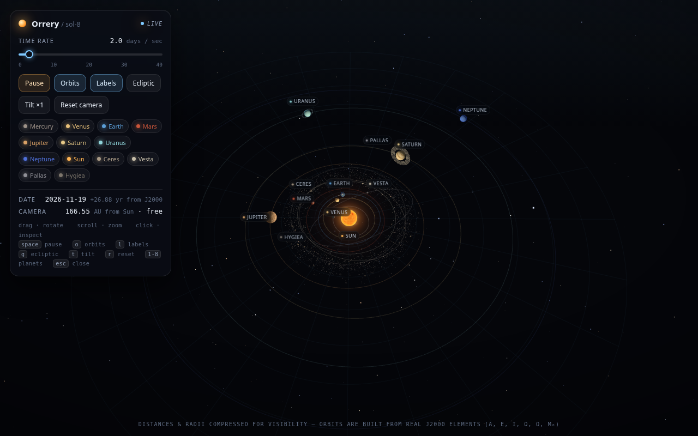
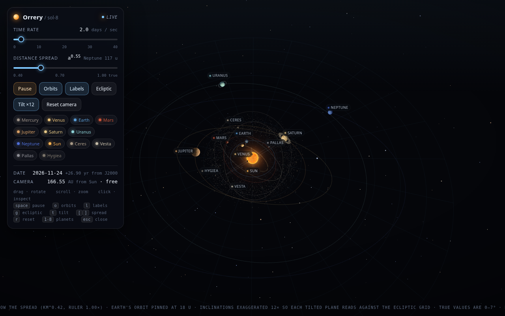

# Orrery — sol-8

A complete 3D solar-system simulation in **one self-contained HTML file**: `index.html`.
No build step, no local assets, no bundler. Every texture (planets, rings, Sun, nebulae,
star sprites) is generated procedurally at runtime; only Three.js is fetched from a CDN.

Open it and you get the Sun, all eight planets on their real orbits, a 4 600-rock asteroid
belt with its Kirkwood gaps, 5 100 twinkling stars, clickable worlds with data cards, and a
control panel.

---

## What it looks like



*Camera 300 units out, 35° above the ecliptic, inclinations at their **true** size: every orbit
is a shallow ring around the reference plane, and the ecliptic grid is what gives them somewhere
to lean.*



*Same camera, **Tilt ×12**: the same eight orbits with each inclination multiplied for viewing, so
the planes fan apart instead of overlapping. Only the drawing is exaggerated — nodes,
eccentricities, periods and positions are untouched.*

Both images are produced by `./test/run.sh docs` in headless Chrome, so they stay in step with
the code.

---

## Run it

```bash
# just open it
xdg-open index.html            # linux
open index.html               # macOS
```

Requires a browser with WebGL2 (any current Chrome / Firefox / Safari / Edge) and an
internet connection for the Three.js module. It is loaded from mirrors in order, so one
working CDN is enough:

1. `https://cdn.jsdelivr.net/npm/three@0.161.0/build/three.module.js`
2. `https://unpkg.com/three@0.161.0/build/three.module.js`
3. `https://esm.sh/three@0.161.0`

The `<script type="module">` tag means the page loads as an ES module. `file://` works in
Chrome (verified headless) and Firefox; some browsers refuse module scripts from `file://`,
in which case serve it locally:

```bash
python3 -m http.server 8000   # then visit http://localhost:8000/index.html
```

---

## Controls

| Input | Effect |
| --- | --- |
| drag (mouse / touch) | orbit the camera around the current focus |
| scroll wheel · pinch | zoom (`MIN_DIST 9` → `MAX_DIST 1100`) |
| click a body | open its data card, highlight its orbit |
| hover a body | tooltip + highlight ring |
| **Time rate** slider | 0 → 40 simulated days per real second |
| **Distance spread** slider `a^0.40 → a^1.00` | how hard the distances are squeezed together; `a^1.00` is *no compression at all* (`[` / `]`) |
| **Pause** | freeze time (also `Space`) |
| **Orbits** | show / hide orbital paths (`O`) |
| **Labels** | show / hide planet labels (`L`) |
| **Ecliptic** | show / hide the ecliptic reference grid (`G`) |
| **Tilt ×1 / ×5 / ×12** | visual exaggeration of orbital inclinations (`T`) |
| **Reset camera** | back to the default 3/4 view (`R`) |
| focus chips (all 13 bodies, incl. Ceres / Vesta / Pallas / Hygiea), `1`–`8` | fly the camera to a planet; `0` = Sun |
| `Esc` | close the card, release the follow camera |

The clock reads the simulated date out loud, e.g. `2026-11-18  +26.87 yr from J2000`, because
the simulation starts on the day you open the page.

Camera motion is critically damped (`damp()` in `updateCamera`), so drags and zooms glide
instead of snapping. Selecting a planet switches the camera into *follow* mode: it rides
with the planet while you keep dragging and zooming around it.

Each card lists diameter, size relative to Earth, distance from the Sun, orbital period,
length of day, orbital inclination, axial tilt ("retrograde spin" when the obliquity is over
90°), moon count, the mean temperature in the subtitle, and a scientific fact.

---

## The orbital model

Positions are not faked with circles and per-planet speed constants. Every orbit is solved
from real **J2000 Keplerian elements** (JPL approximate elements) and every body is placed
in one common frame: the **ecliptic**.

* scene frame: `XZ` plane = ecliptic, `+Y` = ecliptic north pole
* epoch: `EPOCH_MS = Date.UTC(2000, 0, 1, 12, 0, 0)`, and the simulation starts on the
  real current date: `days = (Date.now() - EPOCH_MS) / 86400000`
* mean anomaly: `M = M₀ + 2π · days / period`
* Kepler's equation `M = E − e·sin E` solved by Newton iteration (`solveEccentricAnomaly`)
* perifocal coordinates → `Rz(ω)` → `Rx(i)` → `Rz(Ω)`, i.e. argument of perihelion,
  inclination, longitude of ascending node
* orbit lines are generated with the *same* basis as planet positions, so a planet always
  sits exactly on its drawn ellipse
* group orientation per planet: `rotation.order = 'YXZ'`, `rotation.y = Ω`,
  `rotation.x = i` — no arbitrary per-planet roll anywhere

Catalog (J2000, `au` / `e` / `i` / `Ω` / `ω` / `M₀`):

| planet | a (au) | e | i (°) | Ω (°) | ω (°) | M₀ (°) | period (d) | rot (h) | obliquity (°) |
| --- | --- | --- | --- | --- | --- | --- | --- | --- | --- |
| Mercury | 0.387098 | 0.205632 | 7.004979 | 48.330761 | 29.126967 | 174.792532 | 87.969 | 1407.6 | 0.03 |
| Venus | 0.723332 | 0.006777 | 3.394676 | 76.679843 | 54.922488 | 50.376633 | 224.701 | −5832.5 | 177.40 |
| Earth | 1.000000 | 0.016711 | 0.00005 | 0.0 | 102.94719 | 357.517163 | 365.256 | 23.934 | 23.44 |
| Mars | 1.523662 | 0.093394 | 1.849691 | 49.559539 | 286.49691 | 19.390181 | 686.980 | 24.623 | 25.19 |
| Jupiter | 5.203363 | 0.048386 | 1.304397 | 100.473909 | 274.254567 | 19.667653 | 4332.589 | 9.925 | 3.13 |
| Saturn | 9.537070 | 0.053862 | 2.485992 | 113.665503 | 338.766439 | 317.522406 | 10759.22 | 10.656 | 26.73 |
| Uranus | 19.191264 | 0.047257 | 0.772638 | 74.016925 | 96.937351 | 142.283828 | 30688.54 | −17.24 | 97.77 |
| Neptune | 30.068963 | 0.00859 | 1.769233 | 131.784226 | 273.187128 | 259.908675 | 60195.0 | 16.11 | 28.32 |

Earth is the reference: its own inclination is essentially zero and `Ω = 0`, so its orbit
*is* the ecliptic plane that every other inclination is measured against. Sidereal periods,
rotation periods (Venus and Uranus negative → retrograde spin, which is also why Uranus's
obliquity is over 90°) and obliquities come from the same catalog, so day length, seasons
and the tilted ring planes of Saturn / Uranus are consistent with the orbital geometry.

### Inclinations are real, and the viewer can prove it

Real planetary inclinations are only 0–7°, so at `Tilt ×1` the system genuinely reads as a
nearly flat sheet — that is what the solar system actually looks like. `node test/orbit-report.mjs`
re-implements the textbook convention independently and measures what the app actually draws:

```
planet    max ecl. lat   tilt vs textbook   px lift off ecliptic @ default camera
Mercury       7.005°        7.005°              3.1 px
Venus         3.395°        3.395°              2.4 px
Earth         0.000°        0.000°              0.0 px
Mars          1.850°        1.850°              2.2 px
Jupiter       1.304°        1.304°              3.3 px
Saturn        2.486°        2.486°              6.2 px
Uranus        0.773°        0.773°              3.2 px
Neptune       1.769°        1.769°             13.9 px

max angular disagreement app vs textbook convention: 2.09e-6 deg
plane orientation read back from the geometry (i = tilt from the ecliptic, Ω = node):
planet      as drawn          node applied before tilt      30 deg arbitrary roll
Mercury     7.00° / 48.3° 7.00° / 0.0°  (5.72 off) 7.00° / 78.3°  (3.62 off)
Earth        0.00° / 0.0°             0.00° / 0.0°            0.00° / 30.0°
Neptune     1.77° / 131.8° 1.77° / 0.0°  (3.23 off) 1.77° / 161.8°  (0.92 off)

app reads back i and Ω exactly (worst |drawn − catalog|: 2.28e-9 deg)
```

The last block is the point of the exercise: the drawn planes read back as the catalog `i`
*and* the catalog `Ω`, while the two classic ways of getting this wrong — applying the node
rotation before the inclination (right amount of tilt, tilt about the wrong axis, every node
pinned to 0°), or adding an arbitrary per-planet `rotation.z` "for variety" — throw the planes
off by up to 5.7° and 3.6°, which is as large as the entire real 0–7° spread.

The **Ecliptic** grid (`G`) draws the reference plane, so a tilted orbit visibly leaves it.
Press **Tilt** (`T`) to multiply every inclination by 5 or 12 — purely a viewing aid: the
grid switches on automatically and the footnote states the exaggeration. Periods,
eccentricities, nodes, perihelia and the simulated date are untouched.

### Display scale

Real distances and real radii cannot share one linear scale on a screen, so both are
compressed with separate power curves (declared, not hidden):

```js
const AU_GAIN = 18;                                        // Earth's orbit is pinned at 18 units
let   distPower = DIST_POWER_DEFAULT;                      // 0.55 — and the user can change it
const auToUnit  = au => AU_GAIN * Math.pow(au, distPower); // Neptune at 30.07 au -> 117 units
const unitToAu  = units => Math.pow(Math.max(1e-6, units) / AU_GAIN, 1 / distPower);   // exact inverse
const kmToUnit  = km => 1.25 * Math.pow(km / 6371, 0.42);
const SUN_RADIUS = 4.6;                                    // real value would be 32 units
```

Ordering, eccentricity, inclination and Kepler's second law (faster near perihelion) all
survive the compression; absolute sizes do not. The on-screen footnote says so.

**Distance spread is that exponent, and it is a user setting.** The default is `a^0.55`;
`a^1.00` means *no distance compression whatsoever* — every orbit sits at exactly its `a`
times Earth's, Mercury at `0.387 ×` and Neptune at `30.07 ×` Earth's 18 units (541 units).
The slider runs `DIST_POWER_MIN 0.40` → `DIST_POWER_MAX 1.00` in `DIST_POWER_STEP 0.05`
steps, and `[` / `]` nudge it from the keyboard. Earth stays at 18 units at every setting, so
the two ends of the range are directly comparable.

What follows the setting: each planet's `b.a` is **re-solved** from its real `au` and its
ellipse re-sampled point by point (never stretched), the 4 600 belt shells, the ecliptic grid
(it keeps its fixed `GRID_SPAN_RATIO` to the outer orbit, so its ring density and subtlety do
not change), the overview camera (`cam.dist` tracks `auSpanAt(distPower)`, which is why the
system keeps the same framing at every spread), and the camera AU readout (`unitToAu`).

What does not: `a, e, i, Ω, ω, M₀`, orbit plane orientations, periods, the simulated date,
the AU and million-kilometre figures on the cards, or body radii. The spread changes the
ruler, not the solar system — and the self-test asserts exactly that, by predicting the same
quantities from `18 · au^p` in the harness instead of trusting the app's own conversion.

---

## What is in the scene

* **Sun** — procedural granulation texture with drifting offset, additive limb-glow shell,
  inner/outer corona sprites, animated prominence flares, slow pulsing.
* **Planets** — procedural surface textures (cratered terrain, banded gas giants, caps),
  fresnel atmosphere rim shaders on Venus / Earth / Mars / Jupiter / Uranus / Neptune, an
  Earth cloud shell, Earth's Moon, banded Saturn rings (1.34–2.3 radii) and faint Uranus
  rings (1.55–1.95), each mounted on the planet's real obliquity so axial tilts show.
* **Asteroid belt** — 4 600 animated points between 2.06 and 4.06 au, sampled from a density
  profile with the real **Kirkwood gaps** carved out (4:1, 3:1, 5:2, 2:1, 3:2 and the ν6 edge
  at 2.11 au). Rocks sitting on a resonance are *pumped* — higher eccentricity, higher
  inclination — which is why the swarm reaches inclinations near 24° while the bulk of it stays
  under 10°. Three albedo classes (C-, S-, D-type tints and brightness), every rock with its
  own node, argument of perihelion and Keplerian speed `period = a^1.5 · 365.25`. The belt
  itself is never exaggerated beyond 4× by the tilt viewer.
* **Named asteroids** — Ceres, Vesta, Pallas and Hygiea as individual worlds with real elements
  (inclinations 3.8° – 34.9°), focused by their own chips.
* **Stars** — two depth layers (4 200 far + 900 near) with a custom twinkle shader, plus
  faint nebula sprites for parallax depth.
* **UI** — glassy dark panel, live date readout, camera readout,
  focus chips, keyboard hints, hover tooltip, data card, HTML planet labels with greedy
  decluttering (nearest wins; hovered and selected labels are never culled).

---

## Tests

```bash
./test/run.sh            # full self-test + label test
./test/run.sh selftest   # 157 assertions from 85 check sites
./test/run.sh labels     # label decluttering across 8 camera views
./test/run.sh negatives  # the suite against deliberately broken builds — see "Negative controls"
./test/run.sh shots      # best-effort headless screenshots → test/shot-true.png, test/shot-tilt.png
./test/run.sh docs       # regenerate docs/*.png — the two images at the top of this README
node test/orbit-report.mjs
```

`run.sh` copies `index.html`, injects a harness after the marker
`scene.updateMatrixWorld(true);`, and runs it in headless Chrome (SwiftShader, small
window, virtual-time budget, throw-away profile). **`index.html` is never modified** — the
shipped file contains no test code. Generated scratch copies land in `test/build/`.

Current status: `total 157 · failed 0 · exception None` (85 check sites, all 14 negative
controls catching).

The suite covers geometry and physics (orbit radius vs. real `a`, Kepler ordering, orbit
advance over 200 simulated days, reversibility, **heliocentric direction against an
independently written textbook Kepler propagation**, plane tilt `= i`, ascending node `= Ω`,
drawn orbit coplanarity, ecliptic grid flatness, tilt-viewer scaling, belt inclination spread
and belt node distribution), the **distance spread** (Earth's orbit pinned at 18 units at
every setting, the outer system squeezed inward as the exponent drops, `a^1.00` reproducing
true proportional spacing to Neptune at 30.07 ×, orbit lines **re-solved** from `a(1±e)` at
the new exponent rather than stretched, belt shells and the ecliptic grid following the same
law as the planets, camera framing and the AU readout tracking the live exponent, no angle of
any orbit moving, `a`, `e`, `i`, `Ω`, `ω`, `M₀` and every reported AU/km figure untouched,
the slider and `[` `]` actually driving the scene), the starfield, picking (hover, click, Sun
selection, drag must not select), camera (drag rotate, wheel zoom in/out clamping, follow mode
keeps the target on screen and finite, reset), the UI (speed slider, pause, zero-speed readout,
resume, orbit toggle, label toggle, number-key focus, `Esc`, chips), and rendering (label
overlap and culling checks at eight views, no label outside the viewport, hovered/selected
labels survive decluttering in a deliberately crowded scene, non-black pixels, mean luminance).

The spread and belt assertions deliberately **predict from physics in the harness** rather than
asking the app to agree with itself: `lawUnits(au, p) = 18 · au^p`, the mean rock shell summed
over the 4 600 real `au` values in `beltMeta`, the grid/orbit span ratio, the projected
fraction of the outer orbit that lands inside the frame, and `Math.pow(300/18, 1/p)` for the AU
readout at a fixed camera distance. An assertion that calls `auToUnit()` and then checks the
scene against `auToUnit()` proves only that the code is consistent with itself.

### Negative controls

A green suite means nothing if it passes against broken code, so each load-bearing test was run
against a deliberately wrong variant of `index.html` and confirmed to fail. `./test/run.sh
negatives` does it on demand: `test/negative-controls.py` patches exact snippets of `index.html`
into scratch copies, runs each one through the same headless harness, and **exits non-zero if any
broken build slips through** — a variant that passes is reported as a blind spot.

| broken variant | what the suite says |
| --- | --- |
| `planet-roll-added` — arbitrary per-planet `rotation.z` | `plane tilt Mercury` → 55.72° instead of 7.00°, `ascending node Mercury` → 85° off, `heliocentric direction` → 1.7° off (25 assertions) |
| `node-applied-before-tilt` — `rotation.order = 'XYZ'` | `ascending node Mercury` → 48° off, `heliocentric direction` up to 3.4° wrong (14 assertions) |
| `belt-inclinations-zeroed` | `belt inclination spread is real` → 0 of 4 600 above 5° latitude, max latitude 0.00° |
| `one-shared-belt-node` | `belt ascending nodes are distributed` → `<y² cos 2λ> = −0.405` instead of ≈ 0 |
| `belt-tilt-clamp-removed` (`k = tiltScale`) | `belt tilt exaggeration is capped at 4×` → ×5 moves 4 600 of 4 600 rocks: mean height 3.758× flat at ×4 against 4.525× at ×5 |
| `belt-ignores-spread` — the rocks keep their own law | `the belt follows the same distance law as the planets` → mean rock shell 32.9 u against 27.7 u predicted from 4 600 real `au` at a^0.40 |
| `readout-only-spread` — `auToUnit` pinned at 0.55, only the label moves | `spread 1.00 is true proportional spacing` → Neptune/Mercury still 11.0 = the AU ratio at every spread (7 assertions) |
| `stretched-not-resolved` — new `a`, ellipse never re-sampled | `orbit lines are re-solved …` → drawn extremes off by 7.8e-1, `the view you are looking at survives a spread change` → outer orbit reaches 0.15 – 6.01 of the frame |
| `camera-left-behind` — framing not tied to the span | `reset frames the system …` → camera 210 u against a 541 u orbit; projected reach 0.52 → 220.9 |
| `spread-touches-angles` — the spread also rotates the planes | `no angle of any orbit moves with the spread` → 2.6° / 3.0° of drift |
| `reset-ignores-spread` — `cam.dist = 210` always | `reset frames the system at whatever spread is set` → 210 u against a 541 u orbit at a^1.00 |
| `grid-ignores-spread` — the grid keeps its default size | `the ecliptic grid keeps its span to the outer orbit` → 2.207× at a^0.40 instead of 1.325× |
| `readout-hard-coded-power` — `unitToAu` inverted with the old exponent | `the AU readout inverts the live spread` → 166.6 au where 1 134.0 is expected; `parked on Neptune at true spacing` → 486.95 AU at 541 units |
| label priority **and** placement exemption both removed | `hovered label is never decluttered away` → Mercury disappears from the crowded view |

Three of these deserve a footnote. **Labels** are protected twice: the hovered/selected body is
sorted first (`prio: rank * 1e9 + …`) *and* exempt from the overlap test
(`if (!clashes || c.rank)`). Breaking only one of the two still keeps the promise, and the
suite correctly stays quiet; only removing both trips it, which is when 17 of 17 forced labels
disappear. Because natural crowding is mild, the test manufactures crowding (labels resized to
74 px, body radii ×4) and first asserts that decluttering really is culling 10+ labels —
without that guard the hovered-label assertion would be vacuously true.

**The belt** cannot be checked with a single number: an asteroid's ecliptic **latitude** (what
you see) only reaches its orbital **inclination** (what the model stores) at the node crossing,
so maximum latitude is a weak signal. Instead the test uses a rotation-sensitive second moment,
`<y² cos 2λ>` over the inclined bodies: nodes spread over 360° make the swarm rotationally
symmetric and the statistic collapses to ≈ 0, while one shared node drives it to −0.40.
`test/orbit-report.mjs` applies the same idea to the planets, where the answer is exact rather
than statistical.

**The distance spread** needed its own round of negative controls, because a spread test that
reads the app's own `auToUnit` back is unfalsifiable: `readout-only-spread` (the slider moves
the label but `auToUnit` stays at 0.55) passed every assertion that derived its expectation
from `auToUnit`, and only failed once the harness computed `18 · au^p` itself. That is why the
spread assertions are written the way they are.

Headless Chrome is flaky with large windows and long virtual-time budgets: SwiftShader has to
rasterise every frame, and `--dump-dom` waits for the budget to run out. The defaults
(500×320, budget 3500) are deliberately small; if they exit `124` the harness never finished
in time, so lower `BUDGET` before raising `SIZE`. Everything is tunable:

```bash
SIZE=600,380 BUDGET=5000 ./test/run.sh selftest     # test viewport / virtual-time budget
SHOT_SIZE=480,300 SHOT_BUDGET=2400 ./test/run.sh shots
SHOT_TRIES=6 ./test/run.sh docs                     # retry a stalled capture more often
CHROME=chromium ./test/run.sh all
```

On this machine `--dump-dom` is reliable at 500×320, and screenshots completed at 480×300 and at
1280×800 (short budgets) but stalled at 960×600 and 700×440 — the failure is flaky, not a clean
size limit. A real GPU should raise both. `shot()` deletes the previous PNG before capturing and
retries `SHOT_TRIES` times (3), so it can never report a stale capture as a fresh one; a view that
still fails prints `failed after N tries` and makes the run exit non-zero. `run.sh` exits non-zero
if any assertion fails.

Files:

| path | role |
| --- | --- |
| `index.html` | the deliverable: HTML + CSS + module JS in one file (~2 190 lines, 96 KB) |
| `test/selftest.js` | full harness, injected at runtime |
| `test/labeltest.js` | fast label-only harness (no pixel reads) |
| `test/view_block.js` | camera/tilt pose helper used for screenshots (`#tiltClicks|polar|dist`) |
| `test/orbit-report.mjs` | standalone Node verification of the orbital convention |
| `test/negative-controls.py` | patches deliberately wrong variants of `index.html` and proves the suite notices |
| `test/run.sh` | runner for all of the above (`selftest` / `labels` / `negatives` / `shots` / `docs` / `all`) |
| `test/build/` | generated scratch copies and DOM dumps — safe to delete |

---

## File layout

```
index.html                the whole app — markup, CSS, and the module
README.md
docs/shot-orbits.png      the two screenshots embedded at the top of this README
docs/shot-tilt.png
test/run.sh               test driver (selftest / labels / negatives / shots / docs / all)
test/selftest.js          physics, picking, camera, UI assertions
test/labeltest.js         label overlap and placement at five zooms
test/view_block.js        pixel checks and screenshot injection
test/orbit-report.mjs     standalone Kepler convention cross-check (no browser)
test/negative-controls.py deliberately broken builds, to prove the tests can fail
test/build/               scratch copies with harnesses injected (regenerated each run)
test/shot-*.png           scratch screenshots (gitignored), if you run ./test/run.sh shots
```

`test/build/` and `test/*.png` are generated output — deleting them is always safe. `docs/` is
committed and only changes when you run `./test/run.sh docs` on purpose.

## Tweaking

| want to change | look at |
| --- | --- |
| planet data, colours, facts, textures | `CATALOG` |
| distance / size compression | `auToUnit`, `AU_GAIN`, `DIST_POWER_MIN/MAX/DEFAULT/STEP`, `kmToUnit`, `SUN_RADIUS` |
| how the scene follows the spread | `auSpanAt`, `SPAN_AT_DEFAULT`, `GRID_SPAN_RATIO`, `setDistancePower()`, `resetView()` |
| default view | `cam` / `camSmooth` initial values, `resetView()` |
| zoom limits | `MIN_DIST`, `MAX_DIST` |
| time rate range | the `#speed` input's `min`/`max` |
| inclination exaggeration steps | `TILT_STEPS`, `applyTiltScale()` |
| belt size and spread | `BELT_COUNT`, `beltMeta`, `updateBelt()` |
| star density / twinkle | `starSystem(...)` calls, `starMatFar`, `starMatNear` |
| label crowding rules | `updateLabels()` candidate sorting and overlap test |
| Sun look | `sunGroup`, glow shells, `flares` |

## Data sources

Orbital elements, radii, sidereal rotation periods, obliquities, moon counts and temperatures
follow the public NASA/JPL planetary fact sheets (J2000 approximate Keplerian elements, mean
values). The Sun's 25-day rotation in its card is the canonical synodic-ish figure used for
the surface animation. The scientific facts in the cards are standard textbook statements.
Everything visual — textures, belts, nebulae, flares — is invented procedurally.

## Known limitations (deliberate)

* Distances, radii and belt thickness are compressed — the alternative is an invisible
  simulation. The *distance* compression is a control you can dial: **Distance spread**
  `a^1.00` draws every orbit at its true proportional distance (Mercury at 0.387 ×, Neptune at
  30.07 × Earth's). Radii and belt thickness stay compressed at every setting: framed so that
  Neptune's orbit fits the screen, a to-scale Earth is about a thousandth of a pixel.
  Inclinations, eccentricities, nodes, perihelia, periods and dates are never compressed.
* The asteroid belt is a representative swarm, not real asteroid ephemerides.
* Rendering needs WebGL2 and a CDN round-trip on first load; offline use means vendoring
  `three.module.js` next to the file and editing one URL.
* Positions are propagated from the J2000 elements by mean anomaly only. Inter-planet
  perturbations, element rates and precession are not integrated, so expect differences of a
  small fraction of a degree against a full ephemeris for dates a few decades from J2000, and
  larger ones if you wind the clock centuries forward. The Moon orbits Earth kinematically
  rather than being integrated.
